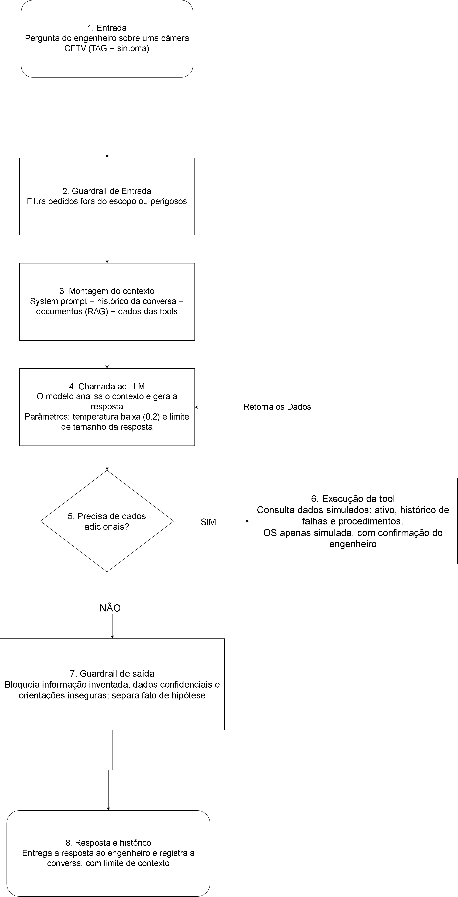

# engman-copilot
Assistente de IA para diagnóstico de falhas em ativos de rodovias (FIAP x Motiva)

## 1. Integrantes

- Bruna Ferreira Santos — RM: [576941] — Turma: 1CCPB
- Isabelle Barbosa de Aguiar Sobral — RM: [576857] — Turma: 1CCPB
- Rafael Meirelles Alves Ferreira — RM: [574688] — Turma: 1CCPB
  
## Problema abordado

O monitoramento das rodovias conta com diferentes equipamentos, como câmeras de CFTV, sensores e painéis de mensagens, que ajudam a acompanhar o trânsito e manter a segurança nas vias. Com o tempo, esses equipamentos podem apresentar falhas, seja pelo uso constante ou pela exposição às condições do ambiente. Quando isso acontece, as equipes de manutenção precisam identificar o problema, entender suas possíveis causas e definir quais medidas devem ser tomadas para que o equipamento volte a funcionar corretamente.

No caso das câmeras de CFTV, essa tarefa pode ser ainda mais difícil. Segundo o briefing da Motiva, as câmeras ficam expostas à chuva, poeira, fuligem, insetos e vibrações, que podem afetar a qualidade das imagens. Um dos problemas apontados é que a identificação de lentes sujas ou imagens desfocadas depende da observação dos operadores do Centro de Controle Operacional (CCO). Ao perceber uma falha, o operador precisa comunicar a equipe de engenharia para que o problema seja avaliado. Esse processo acaba sendo reativo, já que a manutenção depende da identificação da falha, o que pode atrasar a intervenção e comprometer o monitoramento da rodovia.

A dificuldade escolhida pelo grupo está relacionada ao diagnóstico de falhas nas câmeras de CFTV e ao acesso às informações necessárias para orientar a manutenção. De acordo com o briefing da Motiva, uma concessionária pode administrar centenas de câmeras distribuídas por longos trechos de rodovia, o que torna o acompanhamento desses equipamentos mais complexo. O documento também destaca a importância de melhorar a confiabilidade dos equipamentos eletrônicos e utilizar históricos de falhas para apoiar o planejamento da manutenção. Diante desse cenário, o grupo propõe um assistente de inteligência artificial que ajude os engenheiros a consultar registros de falhas, identificar possíveis causas e encontrar procedimentos técnicos. A ideia é facilitar a análise dos problemas e apoiar decisões de manutenção, sem substituir a avaliação dos profissionais.

## Recorte e persona

O grupo escolheu o Recorte A — Diagnóstico e Confiabilidade, com foco no Tema 2.1 — Câmeras de CFTV.

A persona principal do EngMan Copilot é o engenheiro de manutenção da Motiva, responsável por analisar falhas nos equipamentos e orientar os procedimentos de manutenção.

O grupo optou por esse recorte por considerar interessante trabalhar com a identificação de falhas e entender como a tecnologia pode ajudar na manutenção dos equipamentos rodoviários. Entre os equipamentos apresentados no briefing, escolhemos as câmeras de CFTV por sua importância no monitoramento das vias e pelos diferentes problemas que podem afetar seu funcionamento. Já o engenheiro de manutenção foi escolhido como usuário principal porque participa diretamente da análise desses problemas e poderia utilizar o assistente para consultar informações técnicas e apoiar suas decisões.

## Escopo do assistente

### O que o assistente faz

O EngMan Copilot será um assistente de inteligência artificial voltado ao apoio dos engenheiros de manutenção da Motiva no diagnóstico de falhas em câmeras de CFTV. Para isso, terá as seguintes funcionalidades:

- Consulta de equipamentos: acesso a informações como identificação (TAG), modelo, localização e criticidade das câmeras.

- Histórico de falhas: consulta a registros de ocorrências anteriores e manutenções realizadas, permitindo identificar problemas recorrentes.

- Apoio ao diagnóstico: apresentação de possíveis causas para as falhas relatadas, com base nos registros e documentos técnicos disponíveis.

- Consulta de procedimentos: acesso a orientações técnicas de inspeção e manutenção dos equipamentos.

- Avaliação de criticidade: apoio na análise da gravidade das falhas e na definição das prioridades de atendimento.

- Recomendação de manutenção: indicação de possíveis intervenções, como manutenção corretiva, preventiva ou inspeção.

- Ordens de serviço: organização das informações necessárias e solicitação de abertura simulada de uma ordem de serviço, mediante confirmação do engenheiro.

O assistente poderá responder a perguntas relacionadas ao funcionamento das câmeras de CFTV, aos sintomas de falhas, às possíveis causas dos problemas e às intervenções de manutenção. Por exemplo, o engenheiro poderá perguntar se determinada câmera apresenta um histórico de falhas recorrentes, quais fatores podem causar perda de imagem ou quais procedimentos são recomendados para investigar uma falha de comunicação.

Para elaborar suas respostas, o EngMan Copilot consultará informações disponíveis em sua base de conhecimento, como fichas técnicas dos equipamentos, históricos de manutenção, planos preventivos e procedimentos operacionais. As respostas deverão se basear nesses registros, diferenciando informações documentadas de possíveis hipóteses de diagnóstico.

### O que o assistente não faz

O EngMan Copilot terá sua atuação limitada ao apoio técnico no diagnóstico e na manutenção de câmeras de CFTV. Dessa forma, não poderá:

-Analisar imagens ou vídeos: identificar automaticamente problemas visuais nas câmeras, como lentes sujas ou imagens desfocadas.

-Controlar equipamentos: acessar câmeras remotamente para alterar configurações, reiniciar sistemas ou executar reparos.

-Realizar intervenções: executar atividades de manutenção ou substituir a atuação dos profissionais responsáveis.

-Emitir laudos técnicos: produzir diagnósticos definitivos, pareceres ou documentos que exijam responsabilidade técnica de um profissional habilitado.

-Inventar informações: apresentar dados de equipamentos, históricos de falhas ou procedimentos que não estejam disponíveis nas fontes consultadas.

-Atuar fora do escopo: responder a solicitações que não estejam relacionadas à manutenção das câmeras de CFTV.

O EngMan Copilot deverá recusar solicitações fora de seu escopo, pedidos de acesso ou divulgação não autorizada de informações confidenciais e dados pessoais, além de orientações que contrariem os procedimentos oficiais de segurança. Caso não encontre informações suficientes para responder a uma pergunta, deverá informar essa limitação e, quando necessário, solicitar dados adicionais, sem inventar informações.

As recomendações fornecidas pelo sistema, incluindo possíveis causas de falhas, prioridades de atendimento e tipos de intervenção, deverão ser avaliadas pelo engenheiro de manutenção antes de sua aplicação. A abertura simulada de ordens de serviço também dependerá de sua confirmação. Dessa forma, o EngMan Copilot auxiliará na análise e organização das informações, enquanto a responsabilidade pelas decisões técnicas permanecerá com o profissional habilitado.

## Arquitetura da solução

### Fluxograma

### Funcionamento da arquitetura

Quando o engenheiro de manutenção envia uma pergunta, ela passa por oito etapas até virar resposta:

1. **Entrada do usuário:** o engenheiro faz uma pergunta sobre uma câmera CFTV, informando a TAG e o sintoma observado.
2. **Guardrail de entrada:** o sistema verifica se o pedido está dentro do escopo (câmeras CFTV) e se não é perigoso. Pedidos fora do escopo são recusados.
3. **Montagem do contexto:** são reunidos o system prompt, o histórico da conversa, os trechos relevantes da base de conhecimento (RAG) e as ferramentas disponíveis.
4. **Chamada ao LLM:** o modelo de linguagem analisa o contexto e prepara a resposta, com temperatura baixa (0,2) para respostas mais previsíveis e limite de tamanho da resposta.
5. **Decisão sobre consultas:** o modelo avalia se precisa de dados adicionais.
6. **Execução das ferramentas:** se precisar, o assistente consulta dados simulados (ficha do ativo, histórico de falhas e procedimentos) e devolve o resultado ao modelo (retorno ao bloco 4). A ordem de serviço é apenas simulada e depende da confirmação do engenheiro.
7. **Guardrail de saída:** antes de entregar, a resposta é verificada para bloquear informações inventadas, dados confidenciais e orientações inseguras, separando fato de hipótese.
8. **Resposta final e histórico:** a resposta é entregue ao engenheiro e a conversa é registrada, com limite de contexto.

## Stack e justificativa técnica

O detalhamento completo, com fontes e datas de consulta, está em [docs/decisoes_tecnicas.md](docs/decisoes_tecnicas.md).

### Comparação de modelos de linguagem

| Critério | Qwen3 8B (Ollama, local) | Gemini Flash (API do Google) |
|---|---|---|
| Custo | Gratuito (usa o hardware próprio) | Camada gratuita com limites; depois, pago |
| Licença | Apache 2.0 | Termos de serviço do Google |
| Português | 119 idiomas e dialetos; a validar no eval set | Multilíngue |
| Contexto | 32.768 tokens (até 131.072 com YaRN) | Até 1.048.576 tokens |
| Privacidade | Dados ficam no computador local | Na camada gratuita, os dados são usados para melhorar os produtos do Google |
| Integração com Python | Biblioteca `ollama`, com tool calling | SDK do Google, com function calling |
| Maturidade | Boa | Alta, com troca frequente de versões |

### Comparação de bancos vetoriais

| Critério | ChromaDB | FAISS |
|---|---|---|
| Custo | Gratuito | Gratuito |
| Licença | Apache 2.0 | MIT |
| Integração com Python | Nativa e simples | Interface Python sobre C++ |
| Privacidade | Roda localmente | Roda localmente |
| Metadados e filtros | Sim (filtro por TAG, tipo de documento, data) | Não nativamente; exige código extra |
| Limitação | Menos rápido em bases muito grandes | Não é um banco completo, só índices de vetores |

### Tecnologias escolhidas

- **Modelo de linguagem:** Qwen3 8B, executado localmente com o Ollama.
- **Banco vetorial:** ChromaDB.
- **Embeddings:** BGE-M3, também pelo Ollama (licença MIT, mais de 100 idiomas).

O Qwen3 local foi escolhido pela **privacidade**: históricos de manutenção são informações internas e não devem ser enviados a serviços externos. Ele também tem custo zero de uso, licença Apache 2.0 e suporte a tool calling. O ChromaDB foi escolhido por permitir filtrar a busca por metadados, o que ajuda a não misturar informações de câmeras diferentes e a citar a fonte de cada resposta.

**Limitações aceitas:** o modelo local exige um computador com memória suficiente (o arquivo do modelo tem 5,2 GB), é mais lento sem GPU e é menor que os modelos da nuvem. Por isso, os guardrails, a temperatura baixa e a separação entre fato e hipótese são essenciais.

**Execução gratuita:** toda a solução roda em um único computador, sem chave de API paga: Ollama + `qwen3:8b` + `bge-m3` + ChromaDB + um programa em Python que segue as etapas do fluxograma.

## Base de conhecimento

### Documentos previstos

A base de conhecimento do EngMan Copilot será composta por oito tipos de documentos, planejados para apoiar o diagnóstico de falhas e a manutenção de câmeras de CFTV.

| Documento | Informações fornecidas |
|---|---|
| Catálogo de ativos | TAG, modelo, fabricante, localização e criticidade das câmeras. |
| Plano de manutenção preventiva | Atividades, periodicidade e recursos necessários. |
| Histórico de falhas | Ocorrências anteriores, sintomas, causas e reparos realizados. |
| Procedimentos operacionais (POPs) | Orientações para inspeção, limpeza e manutenção. |
| Fichas técnicas | Especificações técnicas dos equipamentos. |
| Matriz de criticidade | Impacto das falhas e prioridades de atendimento. |
| Glossário de siglas | Significados das siglas técnicas utilizadas. |
| Normas e requisitos de segurança | Requisitos de segurança para as atividades de manutenção. |

O detalhamento dos documentos, suas origens e os campos previstos estão disponíveis no [inventário da base de conhecimento](data/knowledge_base/inventario.md).

### Utilização do RAG

O EngMan Copilot utilizará a técnica RAG (Retrieval-Augmented Generation) para consultar informações da base de conhecimento antes de elaborar suas respostas. Quando o engenheiro fizer uma pergunta, o sistema buscará trechos relevantes dos documentos disponíveis e os fornecerá ao modelo de linguagem como contexto.

Os documentos serão divididos em trechos (chunks) de aproximadamente 300 a 500 tokens, permitindo recuperar informações específicas sem precisar utilizar o conteúdo completo de cada arquivo.

Cada trecho terá metadados, como tipo de documento, TAG do equipamento, data, origem e versão. Essas informações ajudarão o sistema a localizar registros relacionados à câmera consultada e evitar a mistura de dados de equipamentos diferentes.

Para proteger a privacidade e a confidencialidade das informações, dados pessoais, imagens que permitam identificar ocupantes de veículos e informações contratuais sensíveis não serão incluídos na base de conhecimento.

Caso não encontre informações suficientes, o assistente deverá informar essa limitação, sem inventar dados ou apresentar hipóteses como fatos.

## System Prompt

[Resumir as principais instruções dadas ao assistente, incluindo seu papel, objetivo, regras, limites e comportamento diante de informações ausentes.]

[Inserir o link para prompts/system_prompt.md.]

## Eval Set

O conjunto de avaliação tem **10 casos de teste** distribuídos nas oito categorias exigidas: 2 factuais, 2 instrucionais, 1 ambíguo, 1 de dado inexistente, 1 fora de escopo, 1 de jailbreak, 1 de risco operacional e 1 de memória de contexto.

Cada caso define a pergunta do engenheiro, onde o assistente deveria buscar a resposta, o que uma boa resposta precisa fazer e critérios verificáveis de avaliação. Os testes verificam se o assistente:

- consulta a fonte correta e a cita na resposta;
- pede a TAG e o sintoma quando a pergunta é vaga, sem adivinhar;
- informa quando não encontra dados, sem inventar informações;
- exige a confirmação do engenheiro antes de abrir uma OS simulada;
- recusa pedidos fora do escopo, tentativas de burlar as regras e orientações perigosas;
- não confunde câmeras diferentes ao longo da conversa.

Arquivo: [evals/sprint1_eval_set.json](evals/sprint1_eval_set.json)

## Tools especificadas

O assistente poderá usar quatro ferramentas, todas com **dados simulados**:

| Ferramenta | Função | Parâmetros principais |
|---|---|---|
| `consultar_ativo` | Retorna a ficha da câmera: modelo, localização, status e criticidade | `tag` |
| `consultar_historico_falhas` | Retorna as falhas e manutenções de uma câmera em um período | `tag`, `janela_meses`, `tipo_falha` (opcional) |
| `abrir_ordem_servico` | Simula a abertura de uma OS, somente após a confirmação do engenheiro | `tag`, `tipo_intervencao`, `prioridade`, `descricao`, `janela_inicio`, `janela_fim`, `confirmado_pelo_engenheiro` |
| `consultar_procedimento` | Retorna o procedimento operacional (POP) aplicável | `tipo_ativo`, `tipo_intervencao` |

Valores permitidos: `tipo_intervencao` = inspecao, preventiva ou corretiva; `prioridade` = baixa, media, alta ou critica. Cada ferramenta também descreve o que acontece em caso de falha, como uma TAG inexistente, sempre sem inventar dados.

Arquivo: [tools/tools_spec.json](tools/tools_spec.json)

## Riscos e mitigações

[Resumir os pelo menos 8 riscos identificados no arquivo docs/riscos_lgpd.md.]

[Explicar o impacto de cada risco e como ele será reduzido por regras do system prompt, verificações da arquitetura ou testes.]

## Limitações conhecidas

O EngMan Copilot encontra-se na fase de planejamento e documentação, portanto, suas funcionalidades ainda não foram implementadas ou validadas em um sistema completo.

A solução utilizará inicialmente dados simulados, pois o grupo não possui acesso às bases internas de manutenção da Motiva. Dessa forma, a qualidade das respostas dependerá da disponibilidade e da confiabilidade dos documentos consultados.

O assistente será limitado ao apoio técnico na manutenção de câmeras de CFTV. Não realizará análise automática de imagens, controle remoto dos equipamentos, intervenções físicas ou diagnósticos definitivos.

A execução local do modelo Qwen3 8B também exigirá recursos computacionais adequados e poderá apresentar desempenho inferior em computadores sem GPU.

Para o funcionamento completo da solução, será necessário implementar o modelo de linguagem, o mecanismo RAG, a base vetorial e as ferramentas planejadas, além de preparar os documentos e realizar testes de funcionamento.

Mesmo após a implementação, o assistente poderá apresentar respostas incompletas ou incorretas. Por isso, suas recomendações deverão ser verificadas pelo engenheiro de manutenção, responsável pelas decisões técnicas.

## Referências

### Briefing do desafio

MOTIVA. *Briefing do desafio de inovação aberta Motiva Rodovias & FIAP*. Material disponibilizado para o Challenge Integrador, 2026.

### Materiais da disciplina

GOMES, Jorge Luiz. *Aula 01 — O que é IA? Da ficção à realidade*. Módulo 1: Fundamentos de IA. FIAP, 2026.

GOMES, Jorge Luiz. *Aula 02 — Como um LLM pensa: tokens, contexto e temperatura*. Módulo 1: Fundamentos de IA. FIAP, 2026.

GOMES, Jorge Luiz. *Aula 03 — Segurança em LLMs: Injection, Alucinação e Guardrails*. Módulo 1: Fundamentos de IA. FIAP, 2026.

GOMES, Jorge Luiz. *Aula 04 — Ética, viés e LGPD: Antes de construir qualquer coisa*. Módulo 1: Fundamentos de IA. FIAP, 2026.

GOMES, Jorge Luiz. *Aula 05 — Anatomia do prompt + Primeiro código Python*. Módulo 2: Técnicas de Prompt. FIAP, 2026.

GOMES, Jorge Luiz. *Aula 06 — Zero-shot, One-shot e Few-shot*. Módulo 2: Técnicas de Prompt. FIAP, 2026.

GOMES, Jorge Luiz. *Aula 07 — Chain-of-Thought: "Pense passo a passo"*. Módulo 2: Técnicas de Prompt. FIAP, 2026.

GOMES, Jorge Luiz. *Aula 08 — Role prompting e parâmetros do modelo*. Módulo 2: Técnicas de Prompt. FIAP, 2026.

### Documentação técnica

As referências utilizadas na comparação e escolha das tecnologias Qwen3, Ollama, ChromaDB e BGE-M3 estão disponíveis no documento [Decisões técnicas](docs/decisoes_tecnicas.md).

